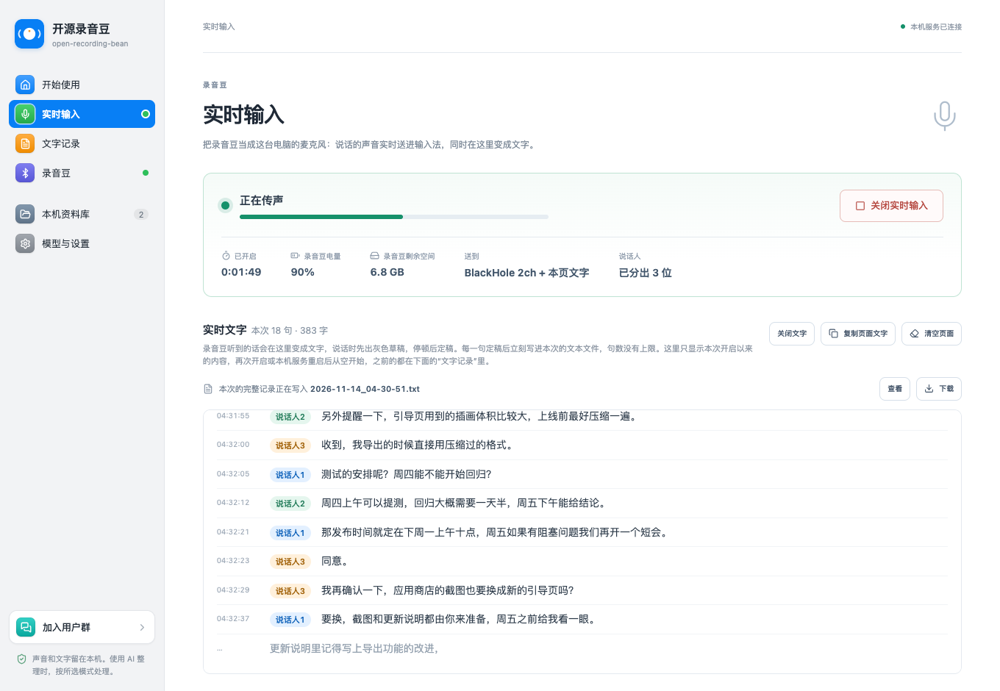
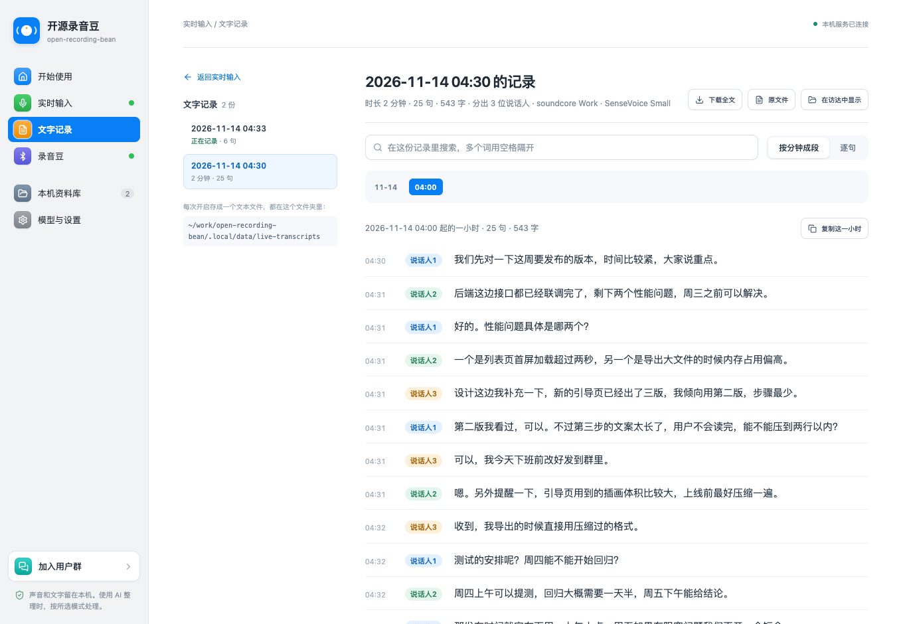
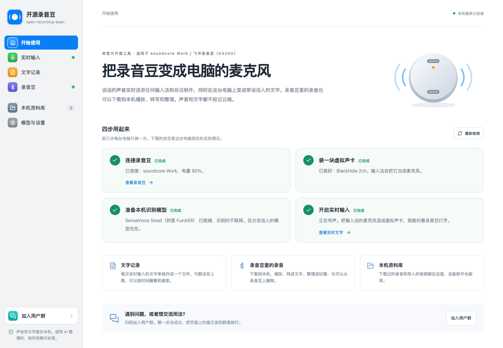

# 开源录音豆 · open-recording-bean

**把录音豆变成电脑的无线麦克风，同时在本机实时转成带说话人的文字。**

适用于 soundcore Work（安克 AI 录音豆、飞书录音豆，型号 D3200，固件版本号支持 04.92，固件升级随时可能让它失效）。
这是非官方的开源独立项目，与 Anker、安克创新、soundcore、飞书无关。[English](#english)



## 它能做什么

| 功能 | 说明 |
| --- | --- |
| **当电脑的麦克风** | 录音豆的声音经蓝牙实时送到电脑，再送进一块虚拟声卡。豆包输入法、Typeless 这类输入法，以及任何能选择麦克风的软件，把虚拟声卡选成麦克风就能用录音豆说话。 |
| **实时文字** | 说话的同时网页上出字：先出灰色草稿，停顿后定稿。由本机的 SenseVoice Small 模型识别，不联网。 |
| **区分说话人** | 每句话前标“说话人1、说话人2…”。只分辨是不是同一个人，不知道姓名，也不保存声纹。 |
| **文字记录** | 每次开启单独存成一个文本文件，句数没有上限，不会互相覆盖。可以按小时翻看、搜索、复制、下载。 |
| **管理录音** | 一键同步全部录音到本机资料库，保留设备原件；复用本机缓存，只补传缺口并核验完整性。断线自动续传，取消后可继续。支持播放、转文字、整理纪要、打包导出及设备删除。没有缓存的旧录音首次仍需完整下载。 |
| **给 Agent 读** | 通过 MCP，Claude Code、Codex 这类 Agent 可以按日期读你保存的文字、搜索、读“刚才说了什么”。只读，不配置就没有。 |
| **留在本机** | 声音、文字、录音都存在这台电脑上。只有你自己选择用云端模型转写或整理，或者让 Agent 来读时，相应的内容才会发出去。 |



## 三步开始

```bash
git clone https://github.com/maple-space/open-recording-bean.git
cd open-recording-bean
./start.sh
```

第一次运行会自动做完这些事，然后打开 <http://127.0.0.1:8875>：

1. 准备项目自己的 Python 环境，安装需要的组件。
2. 构建网页。
3. 自动下载并校验 SenseVoice Small（语音识别）和 CAM++（区分说话人），共约 270 MB；主下载源失败时尝试镜像，中断后可以续传。

模型下载后自动放进项目的 `.local/asr/`，网页会自动识别并使用，无需填写模型路径、申请 API Key 或手动安装模型运行库。首次需要联网下载依赖和模型；模型就绪后，实时语音识别在本机运行。完整步骤见 [新电脑首次运行指南](docs/first-run.md)。

之后再运行 `./start.sh` 就是直接启动。运行它的终端窗口不要关，关掉服务就停了。

**支持 Intel 与 Apple Silicon，无需电脑内置麦克风**：录音豆负责收音，网页把声音送入专属声卡，Typeless 等软件把它作为麦克风。完整设置见 [macOS 安装与使用指南](docs/macos-setup.md)。

需要提前装好的只有两样：

- **Node.js 22.12 或更新**（也支持 20.x 中的 20.19 及以上版本）：`brew install node`，或到 [nodejs.org](https://nodejs.org) 下载。
- **Python 3.10 到 3.13**：`brew install python@3.12`，或到 [python.org](https://www.python.org/downloads/) 下载。电脑上有 `uv` 的话可以不装，脚本会用它准备。

打开网页后，首页的“四步用起来”会按这台电脑的实际情况告诉你还差哪一步：



**哪一步不对？** 运行 `./start.sh doctor`，它会列出这台电脑还缺什么、怎么补。

### 模型下载与配置

| 模型 | 作用 | 自动存放位置 |
| --- | --- | --- |
| SenseVoice Small，约 240 MB | 把语音转成文字 | `.local/asr/sensevoice/model.int8.onnx` 和 `tokens.txt` |
| CAM++，约 28 MB | 给不同声音标注“说话人1、说话人2…” | `.local/asr/speaker/3dspeaker_speech_campplus_sv_zh-cn_16k-common.onnx` |

正常情况只需运行 `./start.sh`；完整且校验通过的文件不会重复下载。源码仓库不包含这约 270 MB 的模型文件，由启动脚本在新电脑上自动获取。下载不完整时，网站仍可启动，但缺少的模型功能暂时不可用。

下载中断后，在项目目录打开另一个终端运行：

```bash
./start.sh models
```

下载源访问失败时可以指定镜像：

```bash
HF_ENDPOINT=https://hf-mirror.com ./start.sh models
```

完成后回到首页点“重新检测”；准备好说话人模型后，下次开启实时输入即可勾选“区分说话人”。无需重启电脑。缺少 SenseVoice 时不能显示本地实时文字；仅缺少 CAM++ 时仍能识别文字，只是不区分说话人。详细检查、离线拷贝和自定义存放位置见 [模型说明](docs/first-run.md#2-模型下载与配置)。

## 让输入法用录音豆说话

输入法只能从“声音设备”里选麦克风，所以要先装一块虚拟声卡来转接。一共三步，前两步每台电脑只做一次。

1. **安装专属声卡**（每台电脑一次）。专属声卡 Recording Bean Audio 2ch 是本项目配套的虚拟声卡，已适配 Typeless 的麦克风选择。到同仓库的 [Recording Bean Audio 2ch 1.0.1 Release](https://github.com/maple-space/open-recording-bean/releases/tag/audio-v1.0.1) 下载 **`RecordingBeanAudio2ch-1.0.1-release.zip`**，解压后双击 **`安装并启用.command`**，按提示输入管理员密码。Intel 与 Apple Silicon 使用同一个安装包（macOS 11+），不需要安装 Xcode，通常也不用重启电脑。装好后由 macOS 自动加载，日常不需要打开任何声卡程序。

   - 声卡没有使用 Apple 开发者证书签名，安装包也没有经过公证，macOS 可能会拦一下。怎么放行、装好后设备没有出现怎么办、以后怎么卸载，见 [macOS 安装与使用指南](docs/macos-setup.md#2-安装专属声卡)。
   - 这个安装包只装声卡，`./start.sh` 不会替你安装它；网站仍然用上面的 `git clone` + `./start.sh` 启动。Release 页面里 GitHub 自动生成的 `Source code` 是源码，不是安装包。
   - 想自己修改或构建声卡，见 [专属声卡的构建说明](tools/recording-bean-audio/README.md)。

2. **把输入法的麦克风改成虚拟声卡**。
   - 豆包输入法：设置 → 语音输入 → 麦克风选择 → 选 “Recording Bean Audio 2ch”。
   - Typeless：设置 → 往下找到“音频” → 麦克风 → 选 “Recording Bean Audio 2ch”。

3. **在网页上开启实时输入**。打开“实时输入”页面，勾选“送到虚拟声卡”，点“开启实时输入”。状态变成“正在传声”后，把光标放进任意输入框，按输入法的语音快捷键，对着录音豆说话。

带示意图的完整教程在网页“实时输入”页面的下方。

用完以后在网页上点“关闭实时输入”，并把输入法的麦克风改回“自动检测”。

## 同步录音到资料库

结束设备录音并关闭实时输入，在 **录音豆** 页面刷新列表，点击 **同步全部录音**。同步保留设备原件，不自动转写或总结；已有本机归档核验通过后会跳过。页面下方的 **后台任务** 显示当前第几条、已完成条数、文件百分比和失败清单。

蓝牙意外断开后，服务会等待原设备恢复并补传缺口。单文件和整批任务都没有 60 分钟总时长限制，但仍会在长时间没有新数据时重连；设备离线等待期间可以取消。单条录音反复无进展或核验失败，会记录失败并继续其他录音，整批不会显示成全部成功。

等待自动重连时，点击 **断开连接 / 停止重连** 会及时停止等待，无需等到整段重试间隔结束，也不会继续尝试连接。已存音频缓存和任务的 **继续同步** 入口会保留。

取消或服务重启后，连接原录音豆，在失败或已取消的后台任务旁点击 **继续同步**，即可复用这台电脑已有的归档和缓存。手机 App 的缓存不与电脑共享。同步期间保持电脑唤醒、本机服务运行；刷新或关闭网页不影响后台任务。完整步骤见 [录音同步指南](docs/recording-sync.md)。

主动点击 **断开连接** 会停止当前批量操作。删除期间，已经发出的那条删除仍可能完成；收到成功回应的条数会保留在任务错误信息中，后续删除和目录核验指令不再发送，删除不会自动重试。重新连接后刷新目录，可确认设备最终保留的录音。

## 给 Agent 用（MCP）

让 Claude Code、Codex、Cursor 这类 Agent 直接读你保存的文字，比如“总结我今天下午说了什么”“上周谁提到过报价”。它是只读的：不能改，不能删，也不会去连录音豆。不配置就等于没有这个功能。

网页左侧的“给 Agent 用”页面里有同样的说明，接入命令已经填好这台电脑上的实际路径，可以直接复制。用 `RECORDING_DATA_DIR` 换过数据文件夹的话，接入时要把同一个值交给 Agent，页面里的命令已经带上了（Claude Code 是在命令里加 `-e RECORDING_DATA_DIR=/你的/文件夹`）。

在 Claude Code 里加一次就行，把路径换成你电脑上项目所在的位置：

```bash
claude mcp add --scope user open-recording-bean -- /你的路径/open-recording-bean/start.sh mcp
```

Codex 写在 `~/.codex/config.toml` 里：

```toml
[mcp_servers.open-recording-bean]
command = "/你的路径/open-recording-bean/start.sh"
args = ["mcp"]
```

其他客户端（Claude 桌面版、Cursor 等）在它的 MCP 配置里加：

```json
{
  "mcpServers": {
    "open-recording-bean": { "command": "/你的路径/open-recording-bean/start.sh", "args": ["mcp"] }
  }
}
```

Agent 能用六个工具：

| 工具 | 作用 |
| --- | --- |
| `list_days` | 哪些天有文字，每天多少句 |
| `read_text` | 读某一天或其中一段时间的实时文字，每句带时间和说话人，内容多时分页 |
| `latest_text` | 读最近几分钟，回答“刚才说了什么” |
| `search_text` | 在实时文字和录音的文字里找词 |
| `list_recordings` | 列出资料库里的录音 |
| `read_recording` | 读一条录音的文字和总结 |

它直接读数据文件夹（默认是 `.local/data`）里的文字记录文件和资料库，本机服务不开也能用。MCP 本身不联网。但 Agent 读到的文字会交给它背后的模型处理，用云端模型的 Agent 就意味着这些文字会发到那个服务。

## 兼容性

| 平台 / 组件 | 支持情况 |
| --- | --- |
| macOS · Intel（`x86_64`） | 支持，已完成功能验证。 |
| macOS · Apple Silicon（`arm64`） | 支持，已完成功能验证。 |
| macOS 版本 | macOS 11 及以上。已在 macOS 15 上完成功能验证；11 到 14 满足各组件的要求，还没有实机验证。 |
| Recording Bean Audio 2ch | macOS 11+ Universal 驱动，一个安装包同时包含上述两种架构。 |
| 录音豆 | soundcore Work D3200，固件 04.92。 |
| 输入法 | 可选择音频输入设备的应用；教程适用于 Typeless 2.11.0、豆包输入法 1.1.0。 |

网站运行还需满足前述 Node.js 与 Python 的系统要求。Windows、Linux 及其他录音豆固件版本暂不在已验证支持范围内。

## 常见问题

- **搜不到录音豆**：录音豆同一时间只能连一个设备。在手机上退出飞书或 soundcore App（或者关掉手机蓝牙），把录音豆从充电盒里取出或按一下按键，再搜索。
- **第一次搜索没反应**：系统会弹出“终端想要使用蓝牙”，要点允许。点了拒绝的话，到“系统设置 → 隐私与安全性 → 蓝牙”里把终端打开。
- **网页上音量条在动，输入法没有字**：输入法的麦克风没有选成虚拟声卡。
- **模型下载不动**：`HF_ENDPOINT=https://hf-mirror.com ./start.sh models` 指定国内镜像；再次运行会接着上次的进度下载。
- **开着实时输入时不能下载录音**：实时输入期间蓝牙被它独占，下载、刷新、删除要先关闭实时输入。
- **连接后从哪里开始实时输入**：设备页点击“进入实时输入”，在下一页开启。折叠区“仅在录音豆上录音”的按钮只控制设备自身录音，声音保存在录音豆里。
- **新录音何时出现在列表里**：连接或重连时读取一次目录，新录音完成后点击“刷新录音列表”。页面不会自己去读录音豆的目录；它定时更新的只是本机服务已有的状态，不发蓝牙指令，也不会锁住按钮。
- **保存录音为什么有时很快、有时很慢**：开启实时输入时，原始音频会同步写入本机缓存；结束后在设备页保存到资料库时，只补传开头、断线期间等缺失片段，并核验边界和尾部，所以很快。中断后再次保存，会接着已写入的部分继续。没有缓存的录音要经低功耗蓝牙完整下载，比较慢：缓存只属于这台电脑，手机上接收过的音频不算。
- **想换个端口，或者换个地方存数据**：`RECORDING_PORT=9000 ./start.sh` 换端口；`RECORDING_DATA_DIR=/你的/文件夹 ./start.sh` 换数据文件夹。换了数据文件夹后，给 Agent 用的接入配置也要带上同一个值，见上面的“给 Agent 用（MCP）”。

## 工作原理

```
录音豆 ──蓝牙──▶ 本机服务（Python）──▶ 解密 ──▶ Opus 解码 ─┬─▶ 虚拟声卡 ──▶ 输入法 / 会议软件
                     │                                      │
                     │                                      └─▶ 切成句子 ──▶ SenseVoice 出字 ──▶ CAM++ 分说话人
                     ▼                                                              │
              网页（React）◀────────────────── 实时文字、文字记录、录音管理 ◀────────┘
```

本机服务只监听 `127.0.0.1`，别的电脑访问不到。蓝牙连接由服务保持，关掉网页不影响传声和后台任务。

代码在这几个地方：

| 位置 | 内容 |
| --- | --- |
| `backend/feishu_protocol.py`、`backend/feishu.py`、`backend/devices.py` | 录音豆的协议和连接：分包、密钥交换、解密、录音列表、下载、删除 |
| `backend/feishu_live.py`、`backend/live.py`、`backend/audio_bridge.py` | 实时传声、送虚拟声卡、文字记录文件 |
| `backend/feishu_cache.py`、`backend/feishu_incremental.py`、`backend/feishu_jobs.py` | 本机音频缓存，保存录音时只补缺口并核验，批量保存和删除 |
| `backend/realtime_asr.py`、`backend/speakers.py` | 实时识别和区分说话人 |
| `backend/asr.py`、`backend/providers.py`、`backend/workflows.py` | 录音的转写和整理 |
| `backend/mcp_server.py`、`backend/text_records.py` | 给 Agent 用的只读接口，读文字记录文件 |
| `backend/app.py`、`backend/storage.py`、`backend/jobs.py` | 本机服务、资料库、后台任务 |
| `src/platform/` | 网页（其中 `AgentPage.jsx` 是“给 Agent 用”页面） |
| `start.sh`、`scripts/` | 安装启动、下载模型、自检 |
| `third_party/recording-bean-audio/`、`tools/recording-bean-audio/` | 专属声卡的驱动源码，以及构建、检测、安装工具 |

## 隐私

- 声音和文字都在本机处理。实时文字用的两个模型下载后离线运行。
- 录音、文字记录、设置都放在项目文件夹的 `.local/` 里，这个文件夹不会被提交到 Git。
- 实时输入期间，电脑上会留一份解密后的原始音频（`.local/data/feishu-audio-cache/`），用来在保存录音时少传数据。它不会自动删除，把录音移到废纸篓或从录音豆删除以后也还在，清理方法见下面的“已知限制”。
- 区分说话人只在一次实时输入期间在内存里比较声音，不保存声纹，也不知道是谁。
- 用“硅基流动 API”“Codex CLI”或“Claude”整理文字时，相应的文字（选 API 转写时还有音频）会发给你选择的那个服务。API Key 只保留在当前网页的内存里，不写入磁盘。
- 给 Agent 用的 MCP 只有你自己配置以后才会被启动。它只读不写，Agent 读到的文字由它背后的模型处理。
- 项目不收集任何使用数据。

## 已知限制

- 只在 macOS 上验证过。把录音移到废纸篓、在访达中显示这些功能依赖 macOS。
- 录音豆同一时间只能连一个设备：电脑连着的时候，手机上的 App 连不上它。
- 实时输入期间录音豆一直在录音，录音同时存在录音豆里，每小时约 29 MB，用完可以在“录音豆”页面删除。
- 电脑上的音频缓存只增不减：每开一小时实时输入约占 37 MB，放在 `.local/data/feishu-audio-cache/`。目前没有自动清理，也没有清理按钮。不需要时，先关闭实时输入并等保存任务结束，再把这个文件夹移到废纸篓；之后保存还没入库的录音，要从录音豆完整下载。
- 区分说话人的弱点：两个人紧挨着说话时，可能被切进同一句；一个新出现的人如果先说了一两个字的短句，这个短句会被算给前一个人。
- 录音豆到电脑走的是低功耗蓝牙，下载长录音比较慢，需要耐心。本项目还没有实现 Wi‑Fi 传输。
- 不做固件升级、解绑、恢复出厂这类操作，也不会去试探没有验证过的指令。固件更新后协议可能变化，功能随时可能失效。

## 参与贡献

欢迎提交问题和代码。没有录音豆也能开发和测试：测试用的是一台按真机实测行为编写的模拟录音豆。

```bash
./start.sh test     # 后端和前端的全部测试
```

提交代码前请先让测试通过。不要提交录音、文字记录、设备序列号或任何密钥；它们都在 `.local/` 里，这个文件夹已经被 Git 忽略。

## 来源与致谢

- 代码基于 [Shawn-TKD/recording-bean-web](https://github.com/Shawn-TKD/recording-bean-web)（MIT）开发，原版权声明保留在 [LICENSE](LICENSE) 里。
- 协议实现参考了社区研究项目 [tacshi/Soundcore](https://github.com/tacshi/Soundcore)（MIT，Copyright (c) 2026 Rocky Shi），并结合本项目在 D3200（固件 04.92）上的实机抓包与验证重新实现。
- 识别用的是 [SenseVoice](https://github.com/FunAudioLLM/SenseVoice)，区分说话人用的是 [3D-Speaker](https://github.com/modelscope/3D-Speaker) 的 CAM++，两者都通过 [sherpa-onnx](https://github.com/k2-fsa/sherpa-onnx) 运行。

完整的第三方来源和许可见 [THIRD_PARTY_NOTICES.md](THIRD_PARTY_NOTICES.md)。

## 免责声明

- 本项目是独立的开源项目，与 Anker、安克创新（Anker Innovations）、soundcore、飞书没有任何关联，也没有得到它们的认可或赞助。文中出现的「Anker」「安克」「soundcore Work」「飞书」「D3200」「录音豆」等，仅用于描述本项目与之互操作的硬件，相关名称、商标归各自权利人所有。
- 本项目仅用于与你自己拥有、或已获明确授权管理的设备进行互操作（interoperability），帮助设备所有者在自己的电脑上使用自己的设备，并把自己的录音从自己的硬件上取回。
- 本项目不包含、不分发任何官方固件、私钥、设备凭据、账号信息或官方 App（APK/IPA）。其中的协议实现参考了公开的社区研究（见上面的“来源与致谢”），并在自己拥有的设备上实测验证。
- 本项目不提供服务器、不托管任何人的数据、不代为运营。数据都保存在使用者自己的电脑上；只有使用者自己选择用云端模型整理文字时，相应内容才会发给那个服务。
- 本项目以个人学习、研究与互操作为目的发布。使用者应遵守所在地区的法律法规，以及相关设备和服务的使用条款。是否适用、如何使用，由使用者自行判断并承担全部责任。
- 请自行备份重要录音。给他人录音前，请遵守当地法律并取得对方同意。
- 本项目不附带任何明示或默示的担保。因使用或无法使用本软件造成的任何后果，作者与贡献者不承担责任。详见 [MIT 许可](LICENSE)。

## 许可

网站、后端与专属声卡在同一仓库维护，按组件分别许可：网站及后端采用 [MIT](LICENSE)；Recording Bean Audio 驱动采用 [GPL-3.0](third_party/recording-bean-audio/LICENSE)，专用构建、检测及安装工具采用 GPL-3.0-or-later。模型及依赖保持各自的上游许可。目录范围、贡献归属和安装包配套源码的发布要求见 [LICENSING.md](LICENSING.md)，来源见 [THIRD_PARTY_NOTICES.md](THIRD_PARTY_NOTICES.md)。

---

## English

**open-recording-bean turns the recorder into a wireless microphone for your Mac, and turns what is said into text with speaker labels, live and on your own computer.**

For the soundcore Work (Anker's AI recorder, also sold as the Feishu recorder 飞书录音豆; model D3200). Firmware 04.92 is supported; a firmware update may break it at any time.
This is an unofficial, independent open-source project. It is not connected with Anker, Anker Innovations, soundcore or Feishu.

- **A microphone for any app.** Live audio from the recorder goes over Bluetooth to a local service and on to a virtual sound card (Recording Bean Audio 2ch), which dictation tools and any app that lets you choose a microphone can use.
- **Live text.** Sentences appear in the browser as you speak, recognised on your Mac by SenseVoice Small. Nothing is sent to a cloud.
- **Speakers told apart.** Each sentence is labelled speaker 1, speaker 2 and so on. Only whether it is the same voice is known, never who it is, and no voiceprint is kept.
- **Text records.** Every session is saved as its own text file, with no limit on length, to browse by the hour, search, copy and download.
- **Recordings.** Sync all recordings to the local library while keeping the originals on the recorder. Sync reuses this computer's cached audio, retrieves missing intervals, and verifies completeness. Interrupted connections recover automatically; cancelled jobs can be resumed. Recordings can be played, transcribed, summarised, exported and deleted. Older recordings without a local cache still need a full first download; audio cached on a phone is not automatically available on this computer.
- **For agents.** Through MCP, agents such as Claude Code or Codex can read the saved text by day, search it and read the last few minutes. Read-only, and absent unless you set it up.
- **Kept on your computer.** Sound, text and recordings stay on this computer. Something leaves it only when you choose a cloud model to transcribe or tidy up a recording, or let an agent read the text.

```bash
git clone https://github.com/maple-space/open-recording-bean.git
cd open-recording-bean
./start.sh          # sets everything up on first run, then opens http://127.0.0.1:8875
```

Requires macOS, Node.js 22.12+ (or 20.x at 20.19+) and Python 3.10 to 3.13; uv can prepare Python if needed. First run installs application dependencies and downloads/verifies approximately 270 MB of speech and speaker models. No API key or model-path configuration is needed. See the [first-run guide](docs/first-run.md).

Intel (`x86_64`) and Apple Silicon (`arm64`) are supported and functionally verified. macOS 11 or later is required: everything has been verified on macOS 15, while macOS 11 to 14 meet the requirements of every component but have not been tested on a real machine. The companion audio driver is a Universal build for macOS 11 or later. Recorder support covers soundcore Work D3200 with firmware 04.92. Windows, Linux and other firmware versions are outside the verified support scope. The interface is in Simplified Chinese.

No built-in microphone is required: the recorder captures speech, the website sends it to Recording Bean Audio 2ch, and Typeless reads the same device as its microphone. Install the companion driver once, then select it in both apps. See the [macOS setup guide](docs/macos-setup.md).

Download **`RecordingBeanAudio2ch-1.0.1-release.zip`** from the [companion driver release](https://github.com/maple-space/open-recording-bean/releases/tag/audio-v1.0.1), extract it and run `安装并启用.command`. One Universal installer covers Intel and Apple Silicon; end users do not need Xcode. The installer installs only the audio driver. Run the website from the cloned source with `./start.sh`; GitHub's generated “Source code” assets are not compiled installers. Current driver builds are ad-hoc signed and the installer is not notarized; what to do when macOS blocks it, and how to remove the driver again, is in the [macOS setup guide](docs/macos-setup.md) (in Chinese). Maintainer release steps are documented in [docs/releasing.md](docs/releasing.md).

A reboot is usually unnecessary. If the driver is not detected, the helper asks before reloading the audio service. If macOS refuses the reload or the device remains unavailable, save your work and restart macOS, then check the device list again.

### Sync recordings to the library

Stop recording and turn off realtime input. On the recorder page, refresh the file list and click **同步全部录音** (sync all recordings). This keeps the originals on the recorder and does not start transcription or summaries. Existing local recordings are checked and skipped when valid. **后台任务** (background jobs) shows the current file, completed count, file progress and any failures.

After an unexpected Bluetooth disconnect, the service waits for the same recorder and resumes the missing audio. Neither an individual transfer nor the whole batch has a 60-minute total time limit. A lack of new data still triggers recovery, and waiting for an offline recorder can be cancelled. A file that repeatedly makes no progress or fails verification is listed as failed while the remaining recordings continue; a partially successful batch is not reported as fully completed.

While waiting to reconnect, clicking **断开连接 / 停止重连** (disconnect / stop reconnecting) stops the wait promptly, without waiting for the full retry interval. No further connection attempts are made. Cached audio and the job's **继续同步** (resume sync) action are preserved.

After cancellation or a service restart, reconnect the original recorder and click **继续同步** (resume sync) beside the failed or cancelled job. This reuses local archives and cached audio; phone caches are separate. Keep the computer awake and the local service running. Refreshing or closing the webpage does not cancel the job. See the [recording sync guide](docs/recording-sync.md) (in Chinese).

Clicking **断开连接** (disconnect) stops the current batch. A delete command already sent may still complete; the job error preserves the acknowledged deletion count. No further delete or directory-verification commands are sent, and deletes are never retried automatically. Reconnect and refresh the directory to confirm which recordings remain.

### For agents (MCP)

Agents such as Claude Code, Codex or Cursor can read the text you have saved: “summarise what I said this afternoon”, “who mentioned the quote last week”. It is read-only: it cannot change or delete anything and never connects to the recorder. Unless you set it up, it does not exist.

The “给 Agent 用” page of the web interface has the same instructions, with the path of your own install already filled in, ready to copy. If the data folder was moved with `RECORDING_DATA_DIR`, the agent needs the same variable; the page adds it for you.

```bash
claude mcp add --scope user open-recording-bean -- /path/to/open-recording-bean/start.sh mcp
```

For Codex, in `~/.codex/config.toml`:

```toml
[mcp_servers.open-recording-bean]
command = "/path/to/open-recording-bean/start.sh"
args = ["mcp"]
```

For other clients (Claude Desktop, Cursor and so on), in their MCP configuration:

```json
{
  "mcpServers": {
    "open-recording-bean": { "command": "/path/to/open-recording-bean/start.sh", "args": ["mcp"] }
  }
}
```

| Tool | What it does |
| --- | --- |
| `list_days` | Which days have text, and how many sentences each |
| `read_text` | The realtime text of a day or of a stretch of it, each sentence with its time and speaker, in pages when it is long |
| `latest_text` | The last few minutes: “what was just said” |
| `search_text` | Find words in the realtime text and in the text of recordings |
| `list_recordings` | The recordings in the library |
| `read_recording` | The text and summary of one recording |

It reads the text record files and the library in the data folder (`.local/data` by default) directly, so it works without the local service running. The MCP itself sends nothing anywhere. What an agent reads is handled by the model behind it, so with a cloud model that text goes to that service.

### Common questions

- **The recorder is not found.** It connects to one device at a time. Quit the Feishu or soundcore app on the phone (or switch off the phone's Bluetooth), take the recorder out of its case or press its button, and search again.
- **Nothing happens on the first search.** macOS asks whether Terminal may use Bluetooth; choose Allow. If it was refused, switch Terminal on under System Settings → Privacy & Security → Bluetooth.
- **The level bar on the page moves but the input method shows no text.** The input method's microphone is not set to the virtual sound card.
- **The model download stalls.** `HF_ENDPOINT=https://hf-mirror.com ./start.sh models` uses a mirror; running it again continues where it stopped.
- **Recordings cannot be downloaded while realtime input is on.** Realtime input owns the Bluetooth link. Switch it off before downloading, refreshing or deleting.
- **Where realtime input starts after connecting.** Choose **进入实时输入** on the recorder page and switch it on there. The collapsed **仅在录音豆上录音** section only controls recording on the recorder itself, where the sound stays.
- **When a new recording appears in the list.** The list is read on connection and reconnection; use **刷新录音列表** after finishing a recording. The page does not read the recorder's directory by itself: its periodic updates only fetch state the local service already has, and send no Bluetooth commands.
- **Why saving is sometimes quick and sometimes slow.** What was recorded with realtime input on is already cached on this computer, so only the missing stretches are fetched and checked. A recording without a cache (audio received on a phone does not count) is downloaded in full over Bluetooth Low Energy, which is slow.
- **Another port or data folder.** `RECORDING_PORT=9000 ./start.sh` changes the port; `RECORDING_DATA_DIR=/your/folder ./start.sh` changes the data folder. With another data folder, the agent's MCP entry needs the same variable.

### Privacy

- Sound and text are processed on this computer. The two models for live text run offline once downloaded.
- Recordings, text records and settings are kept in the project's `.local/` folder, which Git ignores.
- While realtime input is on, a decrypted copy of the raw audio is kept on this computer (`.local/data/feishu-audio-cache/`), so that saving a recording later transfers less. It is not removed automatically, also not when a recording is moved to the Trash or deleted from the recorder; “Known limitations” below says how to clear it.
- Speakers are told apart only by comparing voices in memory during one realtime session. No voiceprint is stored and nobody is identified.
- When you tidy up text with the SiliconFlow API, Codex CLI or Claude, that text (and the audio, if you choose API transcription) is sent to the service you chose. The API key stays in the page's memory and is never written to disk.
- The MCP for agents runs only after you set it up. It is read-only, and what an agent reads is handled by the model behind it.
- The project collects no usage data.

### Known limitations

- Verified on macOS only. Moving recordings to the Trash and showing files in Finder depend on macOS.
- The recorder connects to one device at a time: while the computer holds it, the phone app cannot connect.
- While realtime input is on, the recorder keeps recording to its own storage, about 29 MB an hour. Delete what you no longer need on the recorder page.
- The audio cache on the computer only grows: about 37 MB for every hour of realtime input, in `.local/data/feishu-audio-cache/`. There is no automatic clean-up and no button for it yet. To clear it, switch realtime input off, wait for any save to finish, and move that folder to the Trash; recordings not yet saved to the library are then downloaded in full from the recorder.
- Speaker labels have weak spots: two people speaking right after one another may end up in one sentence, and a new speaker's first one- or two-word sentence is given to the previous speaker.
- The recorder talks to the computer over Bluetooth Low Energy, so downloading long recordings is slow. Wi‑Fi transfer is not implemented.
- No firmware updates, unbinding or factory resets, and no probing of commands that have not been verified. A firmware update may change the protocol and break things at any time.

### Sources and thanks

- The code is built on [Shawn-TKD/recording-bean-web](https://github.com/Shawn-TKD/recording-bean-web) (MIT); its copyright notice is kept in [LICENSE](LICENSE).
- The protocol implementation draws on the community research project [tacshi/Soundcore](https://github.com/tacshi/Soundcore) (MIT, Copyright (c) 2026 Rocky Shi), and was written anew from this project's own packet captures and verification on a real D3200 (firmware 04.92).
- Speech is recognised by [SenseVoice](https://github.com/FunAudioLLM/SenseVoice) and speakers are told apart by CAM++ from [3D-Speaker](https://github.com/modelscope/3D-Speaker), both run through [sherpa-onnx](https://github.com/k2-fsa/sherpa-onnx).

All third-party sources and licences are listed in [THIRD_PARTY_NOTICES.md](THIRD_PARTY_NOTICES.md).

### Disclaimer

- This is an independent open-source project. It has no connection with Anker, Anker Innovations, soundcore or Feishu, and is not endorsed or sponsored by them. Names that appear here, such as “Anker”, “安克”, “soundcore Work”, “飞书” (Feishu), “D3200” and “录音豆”, are used only to describe the hardware this project works with. The names and trademarks belong to their respective owners.
- It is meant only for interoperability with devices that you own or are explicitly authorised to manage: to let owners use their own device on their own computer and take their own recordings off their own hardware.
- It does not contain or distribute any official firmware, private keys, device credentials, account information or official apps (APK/IPA). The protocol implementation draws on public community research (see “Sources and thanks” above) and was verified on a device the author owns.
- It provides no server, hosts nobody's data and runs no service. Data is kept on the user's own computer; only when the user chooses a cloud model to tidy up text is that content sent to that service.
- It is published for personal learning, research and interoperability. Users must follow the laws of where they live and the terms of use of the devices and services involved. Whether and how to use it is for each user to judge, at their own responsibility.
- Back up recordings that matter. Before recording other people, follow local law and get their consent.
- It comes with no warranty of any kind, express or implied. The authors and contributors accept no liability for any consequence of using it or of being unable to use it. See the [MIT licence](LICENSE).

### Licence

One repository, separately licensed components: the website and backend use [MIT](LICENSE); the companion Recording Bean Audio driver uses [GNU GPL v3](third_party/recording-bean-audio/LICENSE), and its dedicated tools use GPL-3.0-or-later. Models and dependencies retain their upstream licences. See [LICENSING.md](LICENSING.md) for scope, contribution ownership and corresponding-source distribution requirements, and [THIRD_PARTY_NOTICES.md](THIRD_PARTY_NOTICES.md) for attribution.

---

## 加入用户群

用微信扫码加入用户群，交流使用方法、反馈问题。

<table>
  <tr>
    <th>加入用户群</th>
  </tr>
  <tr>
    <td align="center"><a href="docs/images/wechat-group.jpg"></a></td>
  </tr>
</table>

群二维码有有效期，以图片标注为准；如果二维码失效，可通过 [Issues](https://github.com/maple-space/open-recording-bean/issues) 提醒更新。点击图片可查看原图。

报告问题也可提交 [Issue](https://github.com/maple-space/open-recording-bean/issues)，请附操作步骤和错误提示，避免公开录音、文字记录或设备序列号。

**Community:** scan with WeChat to join the user group. If the code has expired, open an issue to request an updated code.
