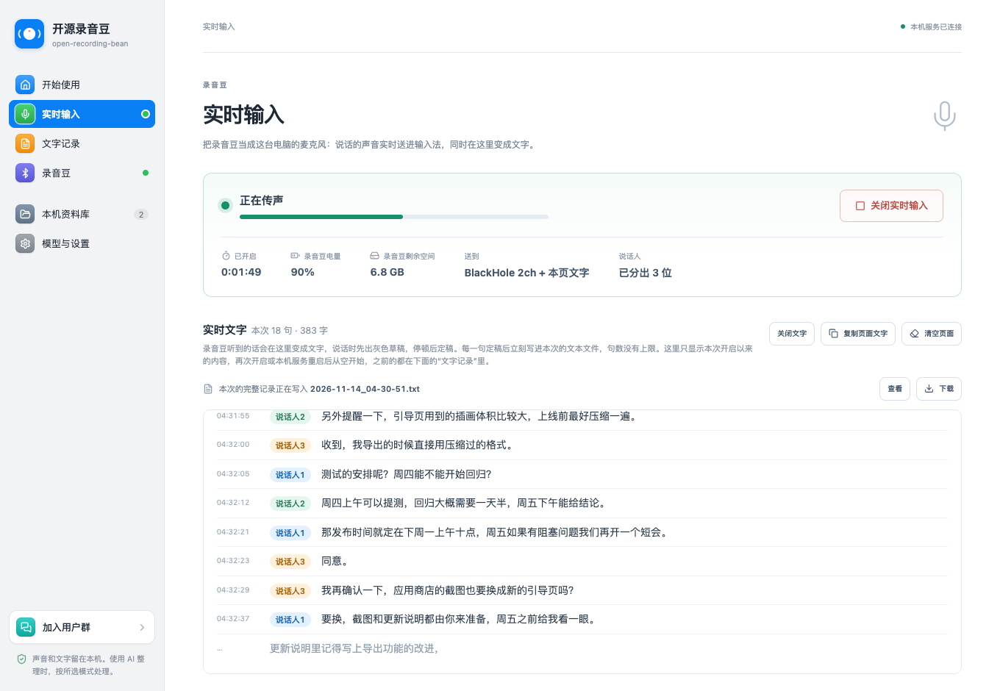
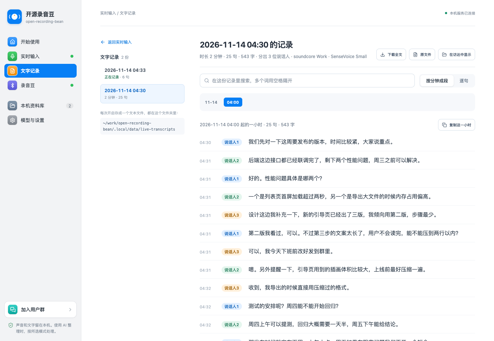
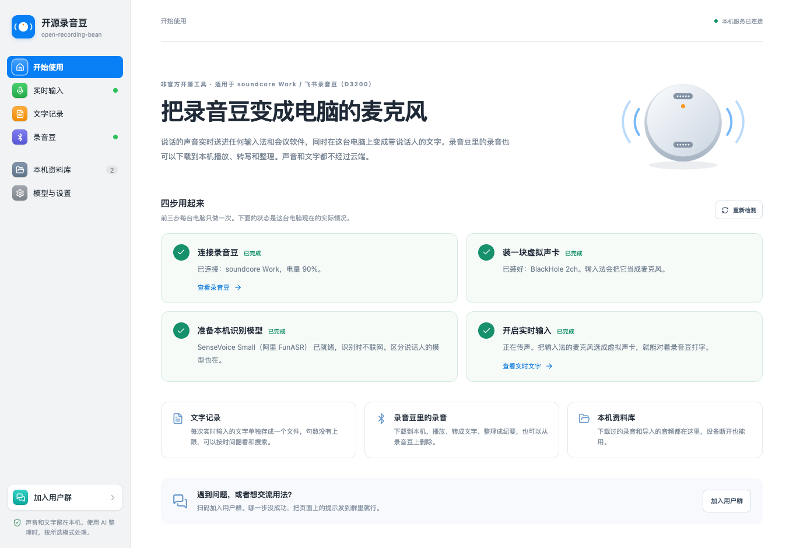

# 开源录音豆 · open-recording-bean

**把录音豆变成电脑的无线麦克风，同时在本机实时转成带说话人的文字。**

适用于 soundcore Work（安克 AI 录音豆、飞书录音豆，型号 D3200）。
这是非官方的开源项目，与安克创新、soundcore、飞书没有关联。[English](#english)



## 它能做什么

| 功能 | 说明 |
| --- | --- |
| **当电脑的麦克风** | 录音豆的声音经蓝牙实时送到电脑，再送进一块虚拟声卡。豆包输入法、Typeless 这类输入法，以及任何能选择麦克风的软件，把虚拟声卡选成麦克风就能用录音豆说话。 |
| **实时文字** | 说话的同时网页上出字：先出灰色草稿，停顿后定稿。由本机的 SenseVoice Small 模型识别，不联网。 |
| **区分说话人** | 每句话前标“说话人1、说话人2…”。只分辨是不是同一个人，不知道姓名，也不保存声纹。 |
| **文字记录** | 每次开启单独存成一个文本文件，句数没有上限，不会互相覆盖。可以按小时翻看、搜索、复制、下载。 |
| **管理录音** | 读取录音豆里的录音，下载到本机，播放、转成文字、整理成纪要、打包导出，也可以从录音豆上删除。 |
| **留在本机** | 声音、文字、录音都存在这台电脑上。只有你自己选择用云端模型整理文字时，那段文字才会发出去。 |



## 三步开始

```bash
git clone https://github.com/maple-space/open-recording-bean.git
cd open-recording-bean
./start.sh
```

第一次运行会自动做完这些事，然后打开 <http://127.0.0.1:8875>：

1. 准备项目自己的 Python 环境，安装需要的组件。
2. 构建网页。
3. 下载两个本机识别模型，共约 270 MB（国内网络会自动换用镜像，中断后可以续传）。

之后再运行 `./start.sh` 就是直接启动。运行它的终端窗口不要关，关掉服务就停了。

需要提前装好的只有两样：

- **Node.js 20 或更新**：`brew install node`，或到 [nodejs.org](https://nodejs.org) 下载。
- **Python 3.10 到 3.13**：`brew install python@3.12`，或到 [python.org](https://www.python.org/downloads/) 下载。电脑上有 `uv` 的话可以不装，脚本会用它准备。

打开网页后，首页的“四步用起来”会按这台电脑的实际情况告诉你还差哪一步：



**哪一步不对？** 运行 `./start.sh doctor`，它会列出这台电脑还缺什么、怎么补。

## 让输入法用录音豆说话

输入法只能从“声音设备”里选麦克风，所以要先装一块虚拟声卡来转接。一共三步，前两步每台电脑只做一次。

1. **装虚拟声卡**。推荐免费开源的 BlackHole：

   ```bash
   brew install blackhole-2ch
   ```

   没有 Homebrew 的话，到 [existential.audio/blackhole](https://existential.audio/blackhole/) 下载 “BlackHole 2ch” 安装包。

2. **把输入法的麦克风改成虚拟声卡**。
   - 豆包输入法：设置 → 语音输入 → 麦克风选择 → 选 “BlackHole 2ch”。
   - Typeless：设置 → 往下找到“音频” → 麦克风 → 选 “BlackHole 2ch”。

3. **在网页上开启实时输入**。打开“实时输入”页面，勾选“送到虚拟声卡”，点“开启实时输入”。状态变成“正在传声”后，把光标放进任意输入框，按输入法的语音快捷键，对着录音豆说话。

带示意图的完整教程在网页“实时输入”页面的下方。

用完以后在网页上点“关闭实时输入”，并把输入法的麦克风改回“自动检测”。

## 和同类项目的关系

围绕这款录音豆已经有几个很好的开源项目，侧重各不相同。本项目是在其中两个的基础上做的，补的是“当麦克风”这一块。

| 项目 | 形态 | 侧重 |
| --- | --- | --- |
| **本项目** | 本机服务加网页，macOS | 录音豆的实时声音送进虚拟声卡，给任何输入法和软件当麦克风；网页上实时出字、区分说话人、逐次保存文字记录；录音管理。Intel Mac 和 macOS 15 可用。 |
| [imraywang/openbean](https://github.com/imraywang/openbean) | 原生 macOS App | 按录音豆的按键说话，文字直接打到光标处；Wi‑Fi 快速同步录音；给 Agent 用的 MCP。要求 macOS 26 和 Apple 芯片。 |
| [Shawn-TKD/recording-bean-web](https://github.com/Shawn-TKD/recording-bean-web) | 纯网页，浏览器直连 | 不用安装，Chrome 或 Edge 打开网页就能连接录音豆、下载和整理录音。本项目的代码基础。 |
| [tacshi/Soundcore](https://github.com/tacshi/Soundcore) | Flutter App | 手机和电脑上的本地管理 App，以及公开的协议研究。本项目协议部分的参考来源。 |

如果你用的是新款 Mac，只想按一下录音豆就打字，openbean 更省事。如果你想继续用自己习惯的输入法或会议软件，或者电脑是 Intel Mac，可以试试本项目。

## 实测情况

下面是实际测过的，没测过的也写明了。

- **测试环境**：MacBook Pro（Intel i9），macOS 15.7；录音豆固件 04.92；虚拟声卡 Soundflower (2ch)。BlackHole 2ch 走的是同一条路径，教程按它写，但还没有在这台机器上实测。
- **输入法**：教程里的界面路径按豆包输入法 1.1.0 和 Typeless 2.11.0 核对过。豆包输入法已实际听写出字。
- **连续运行**：实时传声连续 8 小时 12 分，147 万帧，没有丢帧，没有断连。录音豆每 6 小时自动换一个录音文件，传声不中断。
- **说话人**：用公开语音数据拼成的 2 人和 4 人对话（夹杂一两个字的短句）测试，约 94% 的句子标对。弱点见下面的“已知限制”。
- **还没测过**：Apple 芯片的 Mac（依赖都有对应的安装包，理应可用）；固件 04.92 以外的版本；Windows 和 Linux。欢迎反馈。

## 常见问题

- **搜不到录音豆**：录音豆同一时间只能连一个设备。在手机上退出飞书或 soundcore App（或者关掉手机蓝牙），把录音豆从充电盒里取出或按一下按键，再搜索。
- **第一次搜索没反应**：系统会弹出“终端想要使用蓝牙”，要点允许。点了拒绝的话，到“系统设置 → 隐私与安全性 → 蓝牙”里把终端打开。
- **网页上音量条在动，输入法没有字**：输入法的麦克风没有选成虚拟声卡。
- **模型下载不动**：`HF_ENDPOINT=https://hf-mirror.com ./start.sh models` 指定国内镜像；再次运行会接着上次的进度下载。
- **开着实时输入时不能下载录音**：实时输入期间蓝牙被它独占，下载、刷新、删除要先关闭实时输入。
- **想换个端口，或者换个地方存数据**：`RECORDING_PORT=9000 ./start.sh` 换端口；`RECORDING_DATA_DIR=/你的/文件夹 ./start.sh` 换数据文件夹。

## 工作原理

```
录音豆 ──蓝牙──▶ 本机服务（Python）──▶ 解密 ──▶ Opus 解码 ─┬─▶ 虚拟声卡 ──▶ 输入法 / 会议软件
                     │                                      │
                     │                                      └─▶ 切成句子 ──▶ SenseVoice 出字 ──▶ CAM++ 分说话人
                     ▼                                                              │
              网页（React）◀────────────────── 实时文字、文字记录、录音管理 ◀────────┘
```

本机服务只监听 `127.0.0.1`，别的电脑访问不到。蓝牙连接由服务保持，关掉网页不影响传声和后台任务。

代码在这几个地方：

| 位置 | 内容 |
| --- | --- |
| `backend/feishu_protocol.py`、`backend/feishu.py` | 录音豆的协议：分包、密钥交换、解密、录音列表、下载、删除 |
| `backend/feishu_live.py`、`backend/live.py` | 实时传声、送虚拟声卡、文字记录文件 |
| `backend/realtime_asr.py`、`backend/speakers.py` | 实时识别和区分说话人 |
| `backend/asr.py`、`backend/providers.py`、`backend/workflows.py` | 录音的转写和整理 |
| `backend/app.py`、`backend/storage.py`、`backend/jobs.py` | 本机服务、资料库、后台任务 |
| `src/platform/` | 网页 |
| `start.sh`、`scripts/` | 安装启动、下载模型、自检 |

## 隐私

- 声音和文字都在本机处理。实时文字用的两个模型下载后离线运行。
- 录音、文字记录、设置都放在项目文件夹的 `.local/` 里，这个文件夹不会被提交到 Git。
- 区分说话人只在一次实时输入期间在内存里比较声音，不保存声纹，也不知道是谁。
- 用“硅基流动 API”“Codex CLI”或“Claude”整理文字时，相应的文字（选 API 转写时还有音频）会发给你选择的那个服务。API Key 只保留在当前网页的内存里，不写入磁盘。
- 项目不收集任何使用数据。

## 已知限制

- 只在 macOS 上验证过。把录音移到废纸篓、在访达中显示这些功能依赖 macOS。
- 录音豆同一时间只能连一个设备：电脑连着的时候，手机上的 App 连不上它。
- 实时输入期间录音豆一直在录音，录音同时存在录音豆里，每小时约 29 MB，用完可以在“录音豆”页面删除。
- 区分说话人的弱点：两个人紧挨着说话时，可能被切进同一句；一个新出现的人如果先说了一两个字的短句，这个短句会被算给前一个人。
- 录音豆到电脑走的是低功耗蓝牙，下载长录音比较慢，需要耐心。本项目还没有实现 Wi‑Fi 传输。
- 不做固件升级、解绑、恢复出厂这类操作，也不会去试探没有验证过的指令。固件更新后协议可能变化，功能随时可能失效。

## 社群

用法交流、问题反馈都在微信群里，用微信扫码进群：


群二维码 7 天内有效，过期后会在这里更新。扫不了的话，到 Issues 里说一声。

- 报告问题：到 [Issues](https://github.com/maple-space/open-recording-bean/issues) 里写清楚哪一步不成功、页面上的提示是什么。
- 请不要在公开的地方贴出录音、文字记录或设备序列号。

## 参与贡献

欢迎提交问题和代码。没有录音豆也能开发和测试：测试用的是一台按真机抓包行为编写的模拟录音豆。

```bash
./start.sh test     # 后端和前端的全部测试
```

提交代码前请先让测试通过。不要提交录音、文字记录、设备序列号或任何密钥；它们都在 `.local/` 里，这个文件夹已经被 Git 忽略。

## 来源与致谢

- 代码基于 [Shawn-TKD/recording-bean-web](https://github.com/Shawn-TKD/recording-bean-web)（MIT）开发，原版权声明保留在 [LICENSE](LICENSE) 里。
- 协议实现参考了 [tacshi/Soundcore](https://github.com/tacshi/Soundcore)（MIT，Copyright (c) 2026 Rocky Shi）公开的研究，并在固件 04.92 的真机上重新测量和验证。
- 识别用的是 [SenseVoice](https://github.com/FunAudioLLM/SenseVoice)，区分说话人用的是 [3D-Speaker](https://github.com/modelscope/3D-Speaker) 的 CAM++，两者都通过 [sherpa-onnx](https://github.com/k2-fsa/sherpa-onnx) 运行。
- [openbean](https://github.com/imraywang/openbean) 是同一款硬件上很好的参照，本项目没有使用它的代码。

完整的第三方来源和许可见 [THIRD_PARTY_NOTICES.md](THIRD_PARTY_NOTICES.md)。

## 免责声明

本项目是独立的开源项目，与安克创新（Anker Innovations）、soundcore、飞书没有关联，也没有得到它们的认可或赞助。“soundcore”“Anker”“安克”“飞书”是各自所有者的商标，这里提到它们只是为了说明适用的硬件。协议是为了让你使用自己拥有的硬件而研究的。请只连接你自己的或得到授权的设备，并自行备份重要录音。给他人录音前请遵守当地法律并取得同意。

## 许可

[MIT](LICENSE)

---

## English

**open-recording-bean turns the soundcore Work recorder (D3200, also sold as 飞书录音豆) into a wireless microphone for your Mac, with live local transcription.**

It is an unofficial open-source project, not affiliated with Anker Innovations, soundcore or Feishu.

- **A microphone for any app.** Live audio from the recorder goes over Bluetooth LE to a local service and on to a virtual sound card (BlackHole), which dictation tools and meeting apps can select as their microphone.
- **Live text with speakers.** Sentences appear in the browser as you speak, recognised on your Mac by SenseVoice Small and labelled speaker 1, speaker 2 and so on by a CAM++ speaker model. Nothing is sent to a cloud.
- **Records and recordings.** Every session is saved as its own text file. Recordings on the device can be downloaded, played, transcribed, summarised and deleted.

```bash
git clone https://github.com/maple-space/open-recording-bean.git
cd open-recording-bean
./start.sh          # sets everything up on first run, then opens http://127.0.0.1:8875
```

Requires macOS, Node.js 20+ and Python 3.10 to 3.13. Tested on an Intel MacBook Pro with macOS 15.7 and recorder firmware 04.92. The interface is in Simplified Chinese.

Built on [Shawn-TKD/recording-bean-web](https://github.com/Shawn-TKD/recording-bean-web) (MIT), with protocol research from [tacshi/Soundcore](https://github.com/tacshi/Soundcore) (MIT). See [THIRD_PARTY_NOTICES.md](THIRD_PARTY_NOTICES.md). Licensed under [MIT](LICENSE).
